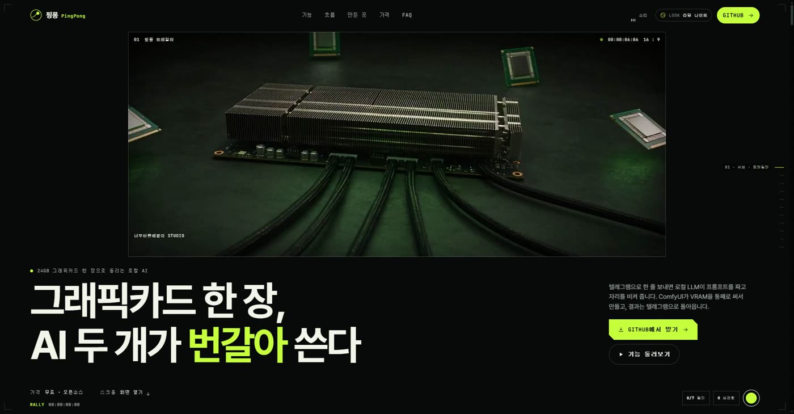

```
   🦗 너무바쁜베짱이 STUDIO 🦗
   P I N G - P O N G   B O T
   ░▒▓ made by 코다 & 크룩스 ▓▒░
```

# 🏓 핑퐁 (VRAM Ping-Pong Bot)

**그래픽카드 한 장, AI 두 개가 번갈아 쓴다.**

> **너무바쁜베짱이** 제작 · 코다 & 크룩스 🦗 · 무료 오픈소스

[](https://pingpong.higgsfield.app)

**소개 사이트:** https://pingpong.higgsfield.app (사이트의 사진·영상은 AI로 만든 이미지입니다)

한 줄로 요청하면 **로컬 LLM이 프롬프트를 짜고 → 자리를 비켜 주고 → ComfyUI가 VRAM을 통째로 써서 생성 → 결과를 보내 줍니다.** 다음 요청이 오면 LLM이 다시 올라옵니다.
24GB 그래픽카드 한 장(RTX 3090급)에서 로컬 LLM과 ComfyUI가 **VRAM을 번갈아 쓰는(핑퐁)** 구조라 둘 다 무리 없이 돌아갑니다.

### 30초 요약

| | |
|---|---|
| **만드는 것** | 이미지(Z-Image Turbo) · 영상(LTX 2.3) · 음악(ACE Step 1.5) · 인물 합성·편집(Flux2 Klein) · 페이스 스왑 |
| **요청하는 곳** | 브라우저 대시보드(기본) · 텔레그램(선택) · 텔레그램 음성 메시지(선택, Faster-Whisper) |
| **편의 기능** | 자연어 에이전트(워크플로를 몰라도 하고 싶은 걸 말하면 됨) · 갤러리 대시보드 · 내 ComfyUI 워크플로 등록 · 대시보드에서 안전 업데이트 |
| **필요한 것** | NVIDIA 24GB 권장 · ComfyUI Desktop · LM Studio · Python 3.10+ |
| **시작** | `설치.bat` 더블클릭 → 브라우저 시작 안내 → 다음부터는 `핑퐁시작.bat` |
| **가격** | 무료 |

---

## 1. 필요한 것 (먼저 갖춰야 함)

### 하드웨어
- **NVIDIA GPU VRAM 24GB 권장** (RTX 3090/4090). 더 적으면 모델·해상도 조정 필요.

### 소프트웨어
| 프로그램 | 용도 | 비고 |
|---|---|---|
| **ComfyUI Desktop** | 실제 생성 | 켜져 있어야 함 (포트 8188) |
| **LM Studio** | 프롬프트 작성용 로컬 LLM | GUI는 안 켜도 됨. `lms` CLI가 자동 기동 |
| **Python 3.10+** | 봇 스크립트 | 설치 시 "Add to PATH" 체크. 패키지는 `.venv`에 설치됩니다. |
| **텔레그램 봇 토큰** (선택) | 폰으로 요청·결과 받기 | 없어도 브라우저 대시보드로 쓸 수 있습니다. 만들 땐 @BotFather → `/newbot` |

---

## 2. ComfyUI 커스텀 노드 (이게 없으면 해당 기능 안 됨)

ComfyUI Manager 등으로 설치. **봇을 켜면 사전점검이 "뭐가 없는지" 콕 집어줍니다.**

- **이미지(ZIT):** `ToobusyZImageTurbo`, `ToobusyHiresUpscale`
- **인물합성/스왑(Klein):** `ToobusyFlux2Klein`, `ToobusyFlux2KleinPromptDirector`, `ToobusyReferenceBoard`
- **영상(LTX 2.3):** `LTXDirector` 계열, `UnetLoaderGGUF`(ComfyUI-GGUF), `VAEDecodeTiled`, KJNodes(`VAELoaderKJ` 등)
- **음악(ACE Step 1.5):** `TextEncodeAceStepAudio1.5`, `EmptyAceStep1.5LatentAudio`, `ReferenceTimbreAudio`, `VAEEncodeAudio` 등

---

## 3. 모델 파일 (ComfyUI `models` 폴더에)

워크플로가 참조하는 파일명·하위폴더 그대로 있어야 합니다.
대시보드의 **READY CHECK → 모델 설정**에서 빠진 모델은 `다운로드` 버튼으로 받을 수 있습니다.
다운로드 파일은 기본적으로 Comfy Desktop 공유 폴더의 `models` 아래에 저장됩니다. 다른 위치를 쓰면 `config.json`에 `comfy_models_dir`를 지정하세요.
ACE Step처럼 Hugging Face에서 권한이 필요한 모델은 `config.json`의 `hf_token` 또는 환경변수 `HF_TOKEN`을 넣어야 다운로드됩니다.
LAN 공개 상태에서는 삭제/정지/재시작/모델 변경/모델 다운로드 요청에 대시보드 보안 키가 자동으로 붙습니다. 키는 `config.json`의 `dashboard_key`에 자동 생성됩니다.

- **ZIT:** `ZIT/zImageTurbo_turbo.safetensors`, `ZIT/zImageTurbo_turbo_txt.safetensors`, `zImageTurboVAE_v10.safetensors`, (LoRA) `ZIT/ZIT_normal_girl01.safetensors`, (업스케일) `4x-ClearRealityV1_Soft.pth`
- **Flux2 Klein:** `FLUX2/flux-2-klein-9b-kv-fp8.safetensors`, `qwenLayerwiseForKlein9b_fp8FP32.safetensors`, `flux2DevFP8GGUF_flux2DevVAE.safetensors`, `gemma4_e4b_it_fp8_scaled.safetensors`
- **LTX 2.3:** `LTX23/ltx23DEVGGUFUnsloth_q4km.gguf`, `LTX23/ltx-2.3-22b-distilled-lora-384-1.1.safetensors`, `LTX23/taeltx2_3.safetensors`, `LTX23/ltx23FP4_*VideoVae/AudioVae/TextProjection`, `gemma_3_12B_it_fp4_mixed.safetensors`, `ltx-2.3-spatial-upscaler-x2-1.1.safetensors`
- **ACE Step 1.5:** `aceStepAudioGen_v15XLTurbo.safetensors`, `aceStepAudioGen_tencQwen06bAce15.safetensors`, `aceStepAudioGen_tencQwen4bAce15.safetensors`, `aceStepAudioGen_vae.safetensors`
- **로컬 LLM (LM Studio):** 무검열 코딩 모델 1개 (예: `qwen3.5-35b-a3b-uncensored`). LM Studio에서 미리 다운로드해 두기.

> 파일명이 다르면 대시보드의 **모델 설정**에서 설치된 모델을 선택하세요. 새로 추가한 커스텀 워크플로의 모델 다운로드 링크는 `config.json`의 `model_downloads`에 직접 추가할 수 있습니다.

---

## 4. 처음 시작하기

1. 이 폴더를 원하는 위치에 둡니다.
2. **`설치.bat`**을 더블클릭합니다.
3. 가상환경과 기본 설정이 준비되면 브라우저에서 **핑퐁 시작 안내**가 자동으로 열립니다.
4. 화면에서 ComfyUI, 생성 기능, 요청 정리 AI의 준비 상태를 확인하고 **핑퐁 작업 엔진 켜기**를 누릅니다.
5. 이미지 기능이 준비됐다면 시작 화면에서 바로 첫 요청을 보낼 수 있습니다.

`config.json`이 없어도 안전한 기본 설정을 자동으로 만듭니다. 텔레그램과 음성 입력은 첫 설치에 필요하지 않으며, 브라우저 시작 안내에서 나중에 연결할 수 있습니다.

이후에는 **`핑퐁시작.bat`**만 실행하면 작업 엔진과 대시보드가 함께 열립니다. 세부 노드·모델 진단이 필요할 때만 **`점검.bat`**을 사용하세요. 기존 콘솔 설정 마법사가 필요하면 `.venv\Scripts\python.exe setup.py`를 직접 실행할 수 있습니다.

### 새 버전으로 업데이트

대시보드의 **⬆ 패치**를 누르면 새 버전의 변경 내용을 먼저 확인할 수 있습니다. 사용자가 체크박스로 수락한 뒤에만 백업과 업데이트가 시작됩니다.

- 적용 전 `config.json`, 에이전트 선호도, 텔레그램 설정, 커스텀 워크플로를 `backups/before-patch-*`에 보관합니다.
- 새 설정값은 기존 취향을 덮지 않고 없는 항목에만 추가됩니다.
- 코드와 Python 패키지를 적용한 뒤 설정 마이그레이션을 실행하고 재시작을 안내합니다.
- 프로그램 파일을 직접 수정한 개발 환경이나 원격에 없는 로컬 커밋이 있으면 자동 적용을 멈춥니다.
- 모델처럼 용량이 큰 기능팩은 일반 코드 패치와 분리하고 별도 동의를 받습니다.

대시보드를 열 수 없는 경우에는 핑퐁을 종료한 다음 **`업데이트.bat`**을 실행할 수도 있습니다. 이 경우에도 터미널에서 적용 여부를 한 번 확인합니다.

- `config.json`, 개인 워크플로, 생성 결과는 업데이트 대상에서 제외되어 그대로 유지됩니다.
- 추적 중인 프로그램 파일을 직접 수정한 경우에는 스크립트가 임시 보관한 뒤 복원합니다.
- 같은 부분을 로컬과 새 버전이 모두 수정해 자동 병합할 수 없으면 파일을 삭제하지 않고 멈추며, 복구용 이름을 화면에 표시합니다.
- Python 패키지 목록이 바뀐 경우 기존 `.venv`도 자동으로 갱신합니다.

---

## 5. 사용법 (텔레그램)

### 에이전트 파일럿

워크플로를 먼저 고르지 않고 하고 싶은 일을 편하게 설명할 수 있습니다. 일반 텍스트와 사진은 기본적으로 에이전트가 먼저 해석합니다.

```text
이 사진을 비 오는 서울 밤거리에서 달리는 6초 영화 같은 영상으로 만들어줘
```

- 텍스트만 보내거나 사진을 캡션과 함께 보낼 수 있습니다. `.에이전트 요청`도 계속 지원합니다.
- Telegram 음성 메시지를 보내면 로컬 Faster-Whisper-XXL로 받아쓴 뒤 같은 에이전트 흐름으로 처리합니다.
- 핑퐁이 요청을 정리하고 현재 등록된 내장/커스텀 워크플로 중 실행 도구를 고릅니다.
- 설치 노드나 모델이 준비되지 않은 워크플로는 가능한 경우 후보에서 제외합니다.
- 실행 전에 정리된 요청, 선택한 방법, 판단 이유와 확신도를 보여줍니다.
- 사진이나 음원이 부족하면 필요한 자료만 추가로 요청합니다.
- **계획대로 실행**을 누르기 전에는 ComfyUI 생성을 시작하지 않습니다.
- 결과에서 **딱 좋아 / 별로야 / 수정할게 / 같은 계획 다시**를 선택할 수 있습니다.
- 좋은 결과의 도구 선택은 로컬 `agent_preferences.json`에 누적되고, 계획·실행·피드백 기록은 `logs/agent_history.jsonl`에만 저장됩니다.
- `좀 더 영화처럼`, `얼굴은 유지하고 배경만 바꿔줘` 같은 짧은 후속 요청은 최근 작업을 이어서 이해합니다.
- 직전 결과에 `스탭수 2만 올려줘`, `CFG 1.5로`, `디노이즈 0.35`, `같은 시드로`, `16:9로 바꿔줘`처럼 말하면 프롬프트를 새로 해석하지 않고 실제 생성 설정의 차이만 보여준 뒤 재실행합니다.
- `film_grain LoRA 강도 0.7 적용해줘`처럼 요청할 수 있습니다. LoRA는 ComfyUI에 실제 설치된 이름과 일치하고 현재 워크플로에 적용 슬롯이 있을 때만 실행합니다. 없는 LoRA나 지원하지 않는 설정은 생성 전에 알려줍니다.
- 여러 샘플러가 있는 커스텀 워크플로에서 `스탭 조금 올려줘`라고 하면 각 단계의 기존 스탭에 각각 `+2`를 적용해 단계별 차이를 보존합니다.
- 생성 결과 메시지에 답장하면서 `이걸 영상으로`라고 하면 답장한 이미지를 입력으로 사용합니다.
- 기존 번호·버튼·슬래시 명령은 모두 그대로 사용할 수 있습니다.

기본 에이전트 해석을 잠시 끄고 예전처럼 일반 텍스트를 바로 이미지 생성으로 보내려면 `config.json`에 `"agent_default": false`를 지정합니다. 음성 전사 실행 파일과 모델은 `agent_whisper_exe`, `agent_whisper_model`로 바꿀 수 있습니다.

실행 확인 정책은 `agent_confirmation`으로 조절합니다. `always`는 항상 확인하고, `uncertain`은 확신도가 `agent_auto_confidence` 이상이면 바로 실행하며, `never`는 필요한 자료만 갖춰지면 확인 없이 실행합니다. 초기 사용에는 `always`를 권장합니다.

### 브라우저 에이전트

대시보드 상단 입력창에 원하는 결과를 적고 **🤖 계획 세우기**를 누르면 텔레그램 없이 같은 에이전트를 사용할 수 있습니다.

- 현재 설치된 내장·커스텀 워크플로 중 알맞은 방법을 자동 선택합니다.
- **＋ 사진·음원**으로 참고 자료를 추가하거나 사진·음원·영상을 상단 입력창에 바로 끌어놓고, 계획과 부족한 입력을 확인한 뒤 실행합니다. 갤러리 결과도 같은 방식으로 다시 첨부할 수 있습니다.
- 완료된 뒤 같은 입력창에 `스탭 조금 올려줘`, `같은 시드로`, `배경만 밤으로 바꿔줘`처럼 적고 다시 **계획 세우기**를 누르면 작업 세션을 이어갑니다.
- 계획과 생성은 모두 기존 공유 큐에서 순차 처리되므로 텔레그램 작업과 GPU를 동시에 점유하지 않습니다.
- 브라우저 세션은 로컬 `browser_agent_sessions/`에만 저장됩니다.
- 기본 화면에서는 이미지·영상·음악 카테고리를 고르지 않습니다. 예전처럼 워크플로와 세부 옵션을 직접 고르려면 **⚙ 직접 선택**을 눌러 수동 생성 화면을 펼칩니다.

하단 버튼 또는 번호로 선택:
- **1️⃣ 이미지** / **2️⃣ 영상** / **3️⃣ 음악** → 버튼 누르면 설명을 물어봄
- **🎧 참고곡 음악** → MP3/WAV/M4A/FLAC/OGG 등을 보내고 새 곡의 분위기·주제를 설명
- 음원 캡션에 **`.음악참고 새 곡 설명`**을 적어 한 번에 실행할 수도 있음
  - 참고곡의 음색·믹싱·연주 질감을 반영하되 새 멜로디와 새 가사를 생성하는 모드
- 대시보드에서는 생성 모드 **`참고곡 음악`** 선택 → **`🎧 참고곡`** 버튼으로 음원 추가 → 설명 입력 → 생성
- **4️⃣ 인물합성/편집** → 사진 1장 (+ 원하는 장면)
- **5️⃣ 페이스스왑** → 사진 2장 (몸 → 얼굴 순서)
- 사진을 그냥 보내면 → "뭘 할까요?" 물어봄
- 취소: `/취소`

---

## 5-1. VRAM이 다를 때 (고급)

기본값은 24GB(RTX 3090급) 기준이에요. VRAM이 다르면 **`config.json`의 `models` 한 줄만** 자기 파일명으로 바꾸면 됩니다. (워크플로 JSON은 건드릴 필요 없음)

```json
"models": {
  "zit":      "ZIT\\zImageTurbo_turbo.safetensors",
  "ltx_gguf": "LTX23\\ltx23DEVGGUFUnsloth_q4km.gguf",   ← 더 작은 gguf로 교체 가능
  "klein":    "FLUX2\\flux-2-klein-9b-kv-fp8.safetensors",
  "ace":      "aceStepAudioGen_v15XLTurbo.safetensors"
}
```

- **규칙: 형식(로더)은 그대로.** gguf 자리엔 gguf(q4km→q3=VRAM↓, q6/q8=↑), safetensors 자리엔 safetensors.
- 봇을 켜면 **사전점검이 "그 파일 있는지" 확인**하고, 없으면 기대 파일명을 알려줘요.
- 영상이 무거우면 `video_width`를 낮추세요(예: 세로숏 `640`).

## 5-2. 갤러리 대시보드 (선택)

생성물을 한눈에 보고, 브라우저에서 바로 생성도 할 수 있는 레트로 대시보드.

- **`run_dashboard.bat`** 더블클릭 → 브라우저에서 `http://127.0.0.1:8910` 자동 열림
- 생성된 이미지가 카드로 쌓임(호버 확대 / 클릭 크게보기 / 좌우 이동 / 숨김·삭제)
- 상단 CRT 모니터로 영상 감상 + 영상 리스트
- 하단 BGM 플레이어로 생성한 음악 재생
- 입력칸 + 생성 버튼으로 대시보드에서 직접 생성 요청
- OPTIONS 바에서 이미지 비율/해상도, 편집 워크플로 해상도, 영상 길이/fps/폭 조절
- 우상단 도트 하트 = 봇 동작 표시 (ONLINE / GENERATING / OFFLINE)

> **생성은 봇이 처리해요.** 대시보드의 생성 요청은 공유 큐(`queue/`)에 들어가고, **`run_bot.bat`(봇)이 켜져 있어야** 순서대로 처리됩니다(텔레그램 요청과 같은 줄에 서서 GPU 충돌 방지). 삭제는 바로 지우지 않고 `.trash` 폴더로 이동돼요.

### LAN에서 대시보드 열기

미니PC에서 핑퐁/ComfyUI를 켜고 메인컴 브라우저로 접속하려면 `config.json`에 아래처럼 설정하세요.

```json
"dashboard_host": "0.0.0.0",
"dashboard_port": 8910
```

그 다음 핑퐁봇 또는 대시보드를 재시작하고, 메인컴에서 `http://미니PC_IP:8910`으로 접속하면 됩니다. Windows 방화벽에서 Python 접근 허용이 필요할 수 있습니다.

## 6. 문제 해결

- **봇 창이 바로 닫힘** → `config.json` 없음. `설치.bat`을 먼저 실행.
- **"⚠️ ○○ 노드 없음"** → 해당 커스텀 노드 미설치. ComfyUI Manager로 설치.
- **생성은 되는데 결과가 이상** → 모델 파일명이 워크플로와 다름. `workflows/` JSON에서 모델명 수정.
- **OOM/멈춤** → VRAM 부족. 영상 해상도(`config.json`의 `video_width`)를 낮추거나 더 작은 모델 사용.
- **봇이 두 번 응답** → 핑퐁 루프가 두 개 떠 있음. 검은 창을 모두 닫고 하나만 다시 시작.

---

## 구조

```
pingpong/
├─ 설치.bat            # 최초 1회: 패키지 설치 + 설정 마법사
├─ 업데이트.bat        # 새 버전 확인 + 안전 업데이트
├─ update_pingpong.ps1 # 업데이트 처리 본체
├─ run_bot.bat         # 봇 켜기 (생성 처리)
├─ run_dashboard.bat   # 갤러리 대시보드 열기
├─ requirements.txt    # Python 의존성
├─ 핑퐁시작.bat / 대시보드.bat
│                      # 한글 호환용 실행 래퍼
├─ setup.py            # 설정 마법사 본체
├─ healthcheck.py      # 설치/실행 점검 도구
├─ 점검.bat            # 점검 도구 실행
├─ pingpong.py         # 봇 오케스트레이터 (+공유 큐 처리)
├─ dashboard.py        # 갤러리 대시보드 서버
├─ config.example.json # 설정 예시 (복사해서 config.json)
├─ workflows/          # ComfyUI 워크플로들 (API 포맷)
└─ (config.json, queue/ 등은 .gitignore 처리)
```

## 7. GitHub로 배포 (제작자용)

이 폴더는 git 레포로 만들어 배포하면 편해요. **`config.json`은 토큰이 들어있어 `.gitignore`로 제외**됩니다.

```bash
git init
git add .
git commit -m "first release"
git branch -M main
git remote add origin https://github.com/<유저명>/<레포명>.git
git push -u origin main
```

받는 사람은: 레포를 clone/다운 → `설치.bat` 실행(→ config.json 자동 생성) → `run_bot.bat`.
(모델·커스텀노드는 용량 때문에 레포에 못 넣어요 — 위 2·3절 목록대로 각자 준비, 사전점검이 빠진 걸 알려줍니다.)

---

🦗 **너무바쁜베짱이 STUDIO** — made by **코다 & 크룩스**
---

## 커스텀 워크플로 추가하기

코드를 수정하지 않고 `config.json` 선언만으로 새 텍스트 프롬프트형 ComfyUI 워크플로를 봇 명령으로 추가할 수 있습니다.

1. ComfyUI에서 워크플로를 **Save (API Format)** 으로 저장한 뒤 `workflows/` 폴더에 넣습니다.
2. 저장한 JSON에서 프롬프트, 시드, `filename_prefix`, 결과 저장 노드 id를 확인합니다. 노드 id는 문자열 키입니다.
3. `config.json`의 `custom_workflows`에 아래처럼 선언합니다.
4. 봇을 재시작한 뒤 `trigger` 명령으로 사용합니다. 예: `/스티커 고양이`

```json
"custom_workflows": {
  "스티커": {
    "file": "workflows/my_sticker.json",
    "trigger": "/스티커",
    "type": "image",
    "llm": "image",
    "agent_enabled": true,
    "agent_description": "텍스트로 귀여운 스티커 이미지를 만드는 빠른 워크플로",
    "prompt_nodes": [["6", "text"]],
    "seed_nodes": [["3", "seed"]],
    "prefix_node": ["9", "filename_prefix"],
    "prefix": "pingpong/sticker_",
    "output_node": "9"
  }
}
```

- `file`: 리포 루트 기준 워크플로 API-format JSON 경로
- `trigger`: 텔레그램 명령 프리픽스
- `type`: `image`, `video`, `audio` 중 하나이며 전송 방식을 결정합니다.
- `llm`: `image`는 이미지 프롬프트 생성, `video`는 영상 프롬프트 생성, `refsheet_video`는 첫 참조 이미지를 비전 LLM이 보고 영상 프롬프트를 생성, `none`은 사용자 텍스트를 그대로 사용합니다.
- `agent_enabled`: `false`이면 에이전트가 자동 선택하지 않고 기존 직접 명령으로만 사용합니다. 기본값은 `true`입니다.
- `agent_description`: 이 워크플로가 언제 유용한지 자연어로 적습니다. 생략하면 이름·파일명·입력 수를 바탕으로 자동 설명합니다.
- `prompt_nodes`: 최종 프롬프트 문자열을 넣을 `[노드id, 필드명]` 목록
- `image_nodes`: 대시보드에서 첨부한 이미지를 넣을 `[노드id, 필드명]` 목록입니다. 예: `LoadImage`의 `image`
- `seed_nodes`: 랜덤 시드를 넣을 `[노드id, 필드명]` 목록이며 생략할 수 있습니다.
- `set_nodes`: 고정값을 넣을 `[노드id, 필드명, 값]` 목록이며 해상도/옵션 기본값을 박아둘 때 씁니다.
- `prefix_node`: `filename_prefix`를 넣을 `[노드id, 필드명]`이며 생략할 수 있습니다.
- `prefix`: `filename_prefix` 앞부분입니다. 뒤에 타임스탬프가 자동으로 붙습니다.
- `output_node`: ComfyUI 실행 결과에서 우선 확인할 저장 노드 id

## 워크플로우 자동 등록 배치파일

`워크플로우등록.bat` 위로 ComfyUI **Save (API Format)** JSON 파일을 드래그앤드랍하면 `workflows/` 폴더로 복사하고 `config.json`의 `custom_workflows`에 등록합니다.

등록 도구가 자동으로 추정하는 항목:

- 프롬프트 입력 노드
- 시드 노드
- 이미지 입력 노드
- 저장 파일명 prefix 노드
- 결과 저장 노드
- 비율 노드(`ratio_preset` 또는 `aspect_ratio`)

특이한 워크플로우는 등록 후 `config.json`에서 노드 id를 한 번 확인해 주세요.

## ComfyUI 환경 스냅샷

이 레포에는 현재 핑퐁 워크플로우를 돌리는 데 사용한 ComfyUI Desktop 스냅샷이 포함되어 있습니다.

- `snapshots/snapshot-comfy-post-update-20260627.json`
- ComfyUI Desktop 또는 ComfyUI Manager의 snapshot restore/import 기능으로 복원합니다.
- 이 스냅샷은 custom nodes와 Python dependencies 기준 환경을 맞추기 위한 용도입니다.
- 모델 파일 자체는 용량 때문에 포함되지 않습니다. `config.json`의 `models` 값과 README의 모델 안내를 확인해서 별도로 준비해야 합니다.
